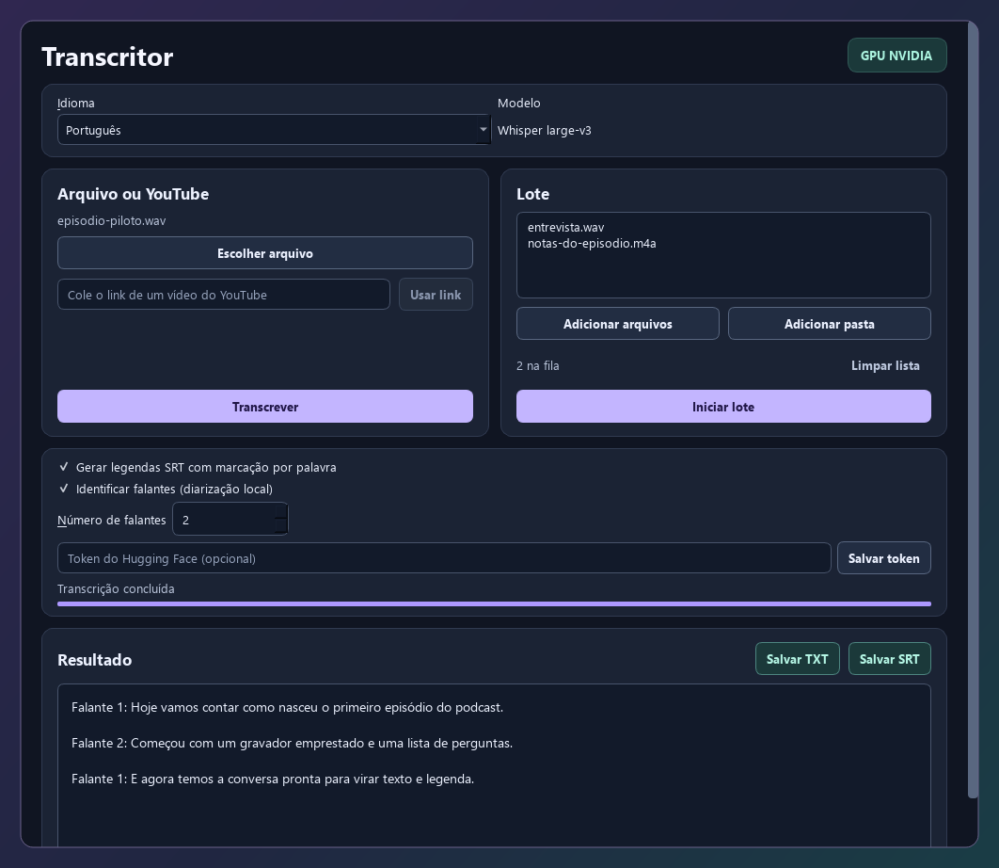

# Audio Transcriber

Transcreva áudio e vídeo no Windows, com identificação de falantes e legendas por palavra.

O processamento roda no seu computador, com o modelo Whisper Large-v3. Você abre uma gravação, cola o link de um vídeo público do YouTube ou monta uma fila de arquivos. A interface e os resultados estão em português.

[Baixar código-fonte](https://github.com/mbenchimol28/audio-transcriber-public/releases/latest) · [Executar no Windows](#executar-no-windows) · [Identificar falantes](#identificar-falantes) · [Gerar um executável](#gerar-um-executável)



*Interface do aplicativo com dados de demonstração.*

## O que dá para fazer

- **Transcrever uma gravação:** abra um arquivo local ou cole o link de um vídeo público do YouTube.
- **Processar uma fila:** adicione arquivos um a um ou pelo primeiro nível de uma pasta. Escolha onde os resultados serão salvos.
- **Separar falantes:** use a detecção automática ou informe o número de vozes. Os rótulos aparecem no resultado e nos arquivos exportados.
- **Exportar a transcrição:** salve em TXT ou ative SRT para ter marcações de tempo por palavra.

## Executar no Windows

Requisitos: Windows 10 ou 11 de 64 bits e Python 3.12 de 64 bits. No PowerShell:

```powershell
git clone https://github.com/mbenchimol28/audio-transcriber-public.git
cd audio-transcriber-public
py -3.12 -m venv .venv
.\.venv\Scripts\python.exe -m pip install -r requirements.txt
.\.venv\Scripts\python.exe app.py
```

Se você baixou o ZIP pela aba [Releases](https://github.com/mbenchimol28/audio-transcriber-public/releases), extraia o arquivo, abra a pasta no PowerShell e comece pelo comando que cria o ambiente virtual.

O primeiro uso baixa o [Whisper Large-v3](https://huggingface.co/Systran/faster-whisper-large-v3). Depois que os modelos estiverem no cache, você pode transcrever arquivos locais sem internet.

- **GPU NVIDIA:** com CUDA 12, cuDNN 9 e um driver compatível, o app usa a GPU. Se a aceleração não estiver disponível ou falhar, a transcrição continua na CPU. Veja os [requisitos de GPU](https://github.com/SYSTRAN/faster-whisper#gpu).
- **YouTube:** instale Deno 2.3 ou superior, ou Node.js 22 ou superior, e deixe o executável no PATH. A mídia temporária é apagada ao final. Veja os [requisitos do yt-dlp](https://github.com/yt-dlp/yt-dlp#dependencies). Use apenas conteúdo que você tem direito de baixar e transcrever, respeitando os [Termos de Serviço do YouTube](https://www.youtube.com/t/terms).

## Identificar falantes

1. Marque **Identificar falantes (diarização local)**.
2. Escolha **Automático** ou informe o número de vozes. No processamento em lote, um número fixo vale para todos os arquivos.
3. Inicie a transcrição. A numeração dos falantes recomeça em cada arquivo.

A diarização roda na CPU e baixa cerca de 41 MB de modelos públicos na primeira execução. Vozes sobrepostas ou parecidas podem receber rótulos imprecisos. Os modelos usados são a [segmentação pyannote](https://huggingface.co/csukuangfj/sherpa-onnx-pyannote-segmentation-3-0) e o [3D-Speaker](https://huggingface.co/csukuangfj/speaker-embedding-models/blob/main/3dspeaker_speech_eres2net_base_sv_zh-cn_3dspeaker_16k.onnx).

O token de leitura do Hugging Face é opcional. Para usá-lo, preencha o campo e clique em **Salvar token**. No Windows, o arquivo `%LOCALAPPDATA%\Transcritor\huggingface.dpapi` é protegido pela conta do usuário. Para apagar o token salvo, limpe o campo e clique em **Salvar token** de novo.

## Gerar um executável

Com o ambiente virtual preparado, instale as dependências de empacotamento e rode o script de build:

```powershell
.\.venv\Scripts\python.exe -m pip install -r requirements-build.txt
powershell -NoProfile -ExecutionPolicy Bypass -File .\build.ps1
```

Abra `dist\Transcritor\Transcritor.exe`. Para mover o aplicativo, copie a pasta `Transcritor` inteira, incluindo `_internal`.

Para compilar sem as bibliotecas NVIDIA, acrescente `-CpuOnly` ao comando. O resultado fica em `dist\portable\Transcritor`.

## Privacidade e desenvolvimento

A transcrição e a diarização são locais. O app desativa a telemetria do Hugging Face e do Deno. Há conexão externa só para baixar modelos ou para obter o áudio de um link do YouTube que você informar. Os modelos são baixados em commits fixos do Hugging Face, então mudanças nos repositórios de origem não alteram o que o app executa.

Para rodar os testes:

```powershell
.\.venv\Scripts\python.exe -m unittest -v
```

## Licença

Distribuído sob a [licença MIT](LICENSE). Os modelos Whisper, pyannote e 3D-Speaker e as bibliotecas usadas seguem as licenças dos respectivos projetos.
